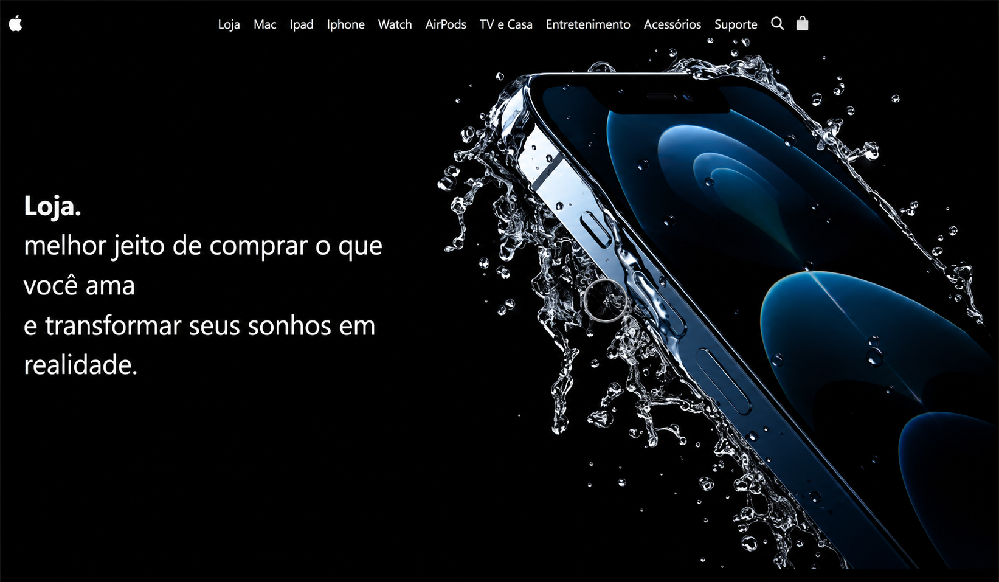
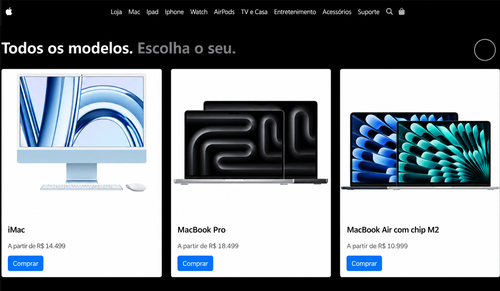
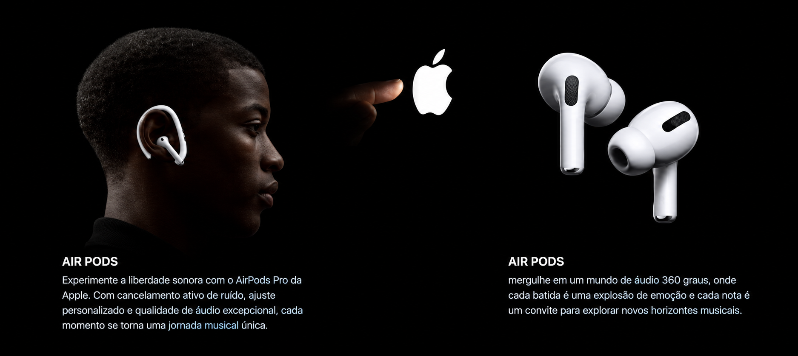

# Apple Storefront

### Projeto-desafio de desenvolvimento web

Site inspirado na identidade visual da Apple, criado para praticar o desenvolvimento de interfaces responsivas e explorar uma estética escura e minimalista.

[**Acessar o site**](https://rflavia.github.io/apple-ecommerce-website/)

## Tecnologias

- HTML
- CSS
- Bootstrap
- JavaScript

## Outras telas

**Modelos de Mac**

**Seção dos AirPods**

##
Projeto independente, desenvolvido para fins de estudo e portfólio. Sem vínculo oficial com a Apple.
